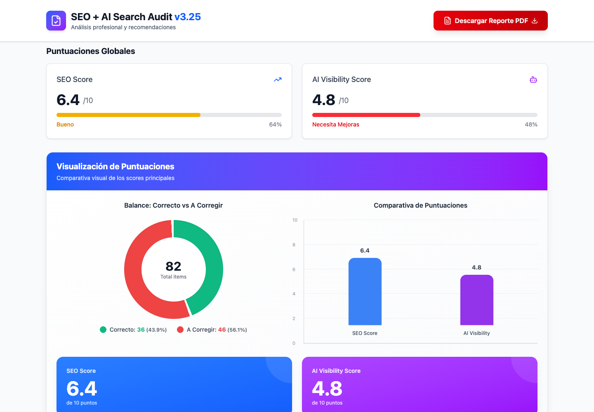
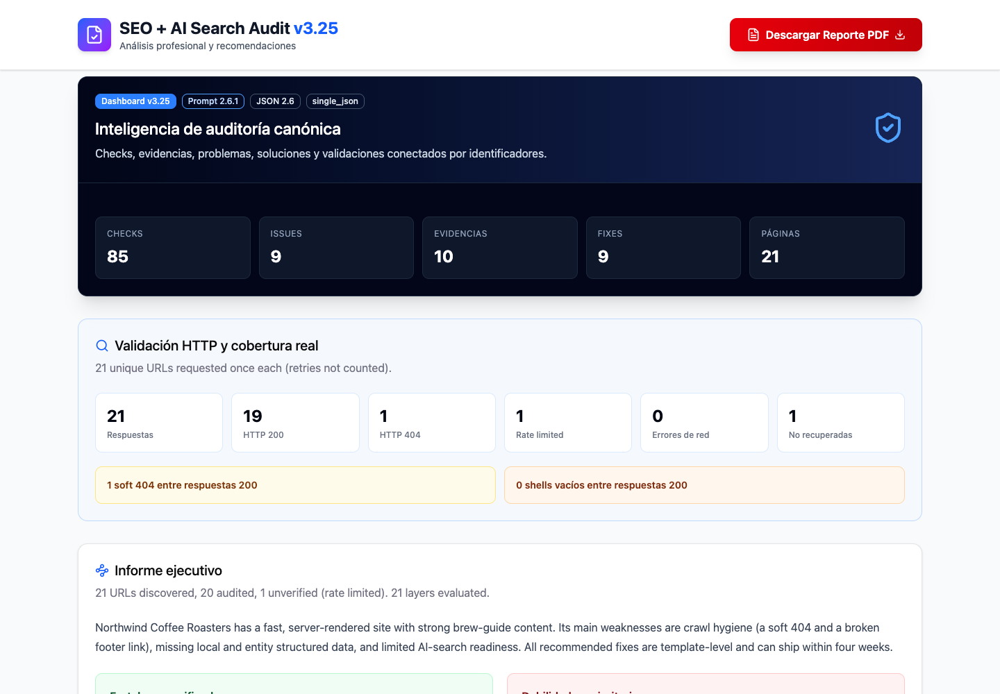
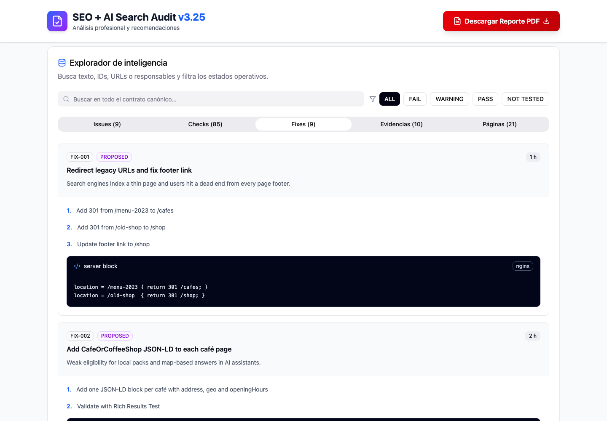
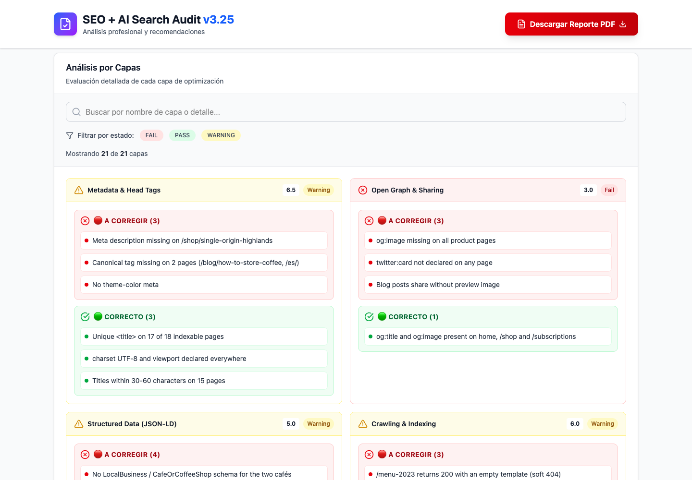
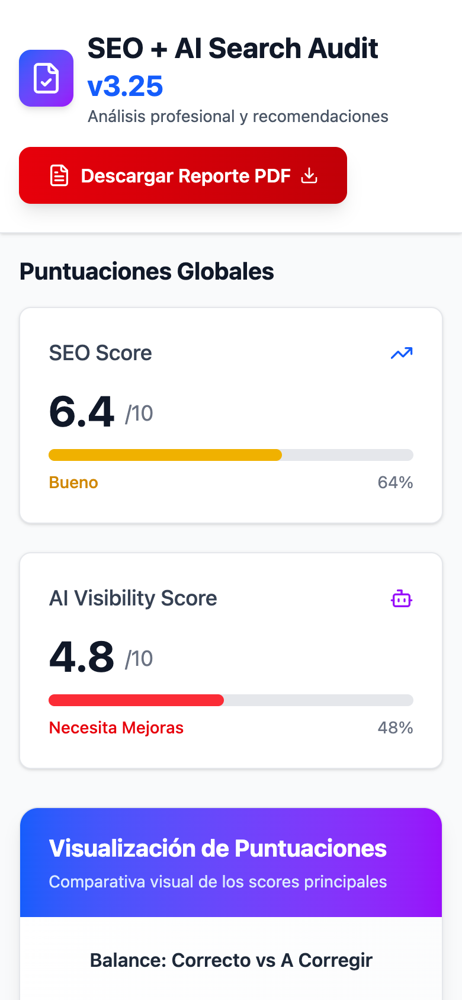

# SEO + AI Search Audit Dashboard

An interactive React dashboard that turns a machine-generated **SEO + AI Search audit** (a single JSON file, schema 2.6) into a client-ready report: scores, charts, a 21-layer analysis, linked issues → fixes → roadmap tasks → validation tests, and a one-click PDF export.

It is one half of a two-part workflow. The other half is the **master audit prompt** in [`docs/`](docs/seo_master_audit_codex_v2.6.1.md), which an AI coding agent runs against a live website to produce the JSON this dashboard reads.



> All data shown in this repository is **fictional**. The sample audit describes an invented business, *Northwind Coffee Roasters*, on the placeholder domain `www.example-coffee.com`.

---

## How it works

**Master prompt** → **AI agent audits the site** → **`SEO_MASTER_AUDIT.json`** → **Dashboard** → **PDF report**

1. **Master prompt** – [`docs/seo_master_audit_codex_v2.6.1.md`](docs/seo_master_audit_codex_v2.6.1.md) is a long, structured instruction set (written in Spanish/English) for an AI coding agent such as Codex or Claude Code. It defines:
   - a URL discovery engine (sitemap, navigation parsing, recursive crawling, JS routes, pattern probing) for sites with or without a sitemap;
   - **21 audit layers** – metadata, Open Graph, structured data, crawling & indexing, AI search optimization, content structure, rendering, internal linking, analytics, Core Web Vitals, entity SEO, information architecture, link graph, content depth, search intent, indexation health, SERP optimization, performance, content modularity, image SEO and **WebMCP & AI-readiness** (`llms.txt`, `actions.json`, entity credibility, hreflang integrity, CTA clarity, manual AI-assistant visibility checks);
   - strict data-quality rules: no invented metrics, `NOT_TESTED` / `N/A` instead of fake passes, rate-limited pages kept as `UNVERIFIED`, projections labelled as scenarios when there is no baseline;
   - the exact **JSON contract** (schema 2.6) the dashboard expects.
2. **Agent run** – the agent is pointed at a site (`Audit [SITE_URL] …` activation prompt at the end of the file) and uses shell tools (`curl`, HTML parsing, JSON-LD extraction, Lighthouse, etc.) to collect evidence.
3. **One JSON file** – the only deliverable is `SEO_MASTER_AUDIT.json`. Everything is linked by IDs: `checks[]` → `issues[]` → `fixes[]` (with code snippets) → `roadmap_tasks[]` → `validation_plan[]`, backed by `evidence[]` and a `pages[]` inventory. Legacy v2.5 fields are kept for backward compatibility.
4. **Dashboard** – drag the JSON onto the upload area (or click **Load sample audit**). The app normalizes several historical formats into one view model and renders every section.
5. **PDF** – *Descargar Reporte PDF* generates a branded, multi-page report in the browser with jsPDF.

## Features

- **Drag-and-drop JSON upload** with a built-in fictional sample (`samples/sample-audit.json`).
- **Format normalization** – reads schema 2.6 as well as older audit formats (v1, v2.x, v5, v11-style), mapping them into one consistent model (`normalizeData` in `src/app/App.tsx`).
- **Scores** – SEO and AI-visibility scores, pass/fix balance donut, score comparison chart, layer status chart, granular score breakdown with weights.
- **21-layer analysis** with search and status filters; each layer shows what passes and what needs fixing.
- **Audit intelligence explorer** – searchable, filterable tabs for issues, checks, fixes (with ready-to-review code snippets), evidence and pages; HTTP validation and coverage (200 / 404 / 429 / soft-404).
- **Executive report**, priority fixes, quick wins, 4-week implementation roadmap, linked roadmap tasks and a validation plan.
- **WebMCP & AI-readiness card** (Layer 21), URL discovery, local SEO, competitive analysis, expected outcomes (3 / 6 / 12 months), AI-visibility opportunities, market context, score trend over previous audits.
- **Data quality & provenance** – schema validation, legacy-compatibility check, methods used.
- **Comparison tab** – upload two audits to compare scores and changes over time.
- **PDF export** of the full report.
- Responsive layout (desktop and mobile).

> The interface labels are in Spanish (the tool was built for Spanish-speaking clients); the sample data is in English.

## Screenshots

| | |
|---|---|
|  |  |
| **Audit intelligence** – counts, HTTP validation, executive report | **Explorer** – fixes with instructions and code snippets |
|  |  |
| **21-layer analysis** with filters | **Mobile** (390 px) |

## Tech stack

- **React 18** + **TypeScript**, bundled with **Vite 6**
- **Tailwind CSS 4** and **shadcn/ui** (Radix UI primitives)
- **Recharts** for charts, **lucide-react** icons
- **jsPDF** for client-side PDF generation
- No backend: everything runs in the browser; uploaded files never leave the user's machine.

## Getting started

Requirements: Node.js 18+ (20 or 22 recommended).

```bash
npm install
npm run dev        # start the dev server (http://localhost:5173)
npm run build      # production build into dist/
npm run preview    # serve the production build locally
```

Then open the app and either click **Load sample audit** or drop your own `SEO_MASTER_AUDIT.json` onto the upload area.

### Generating your own audit

1. Open [`docs/seo_master_audit_codex_v2.6.1.md`](docs/seo_master_audit_codex_v2.6.1.md) in an AI coding agent that can run shell commands and fetch URLs.
2. Use the activation prompt at the end of the file, replacing `[SITE_URL]` and `[DIRECTORY_PATH]`.
3. Load the resulting `SEO_MASTER_AUDIT.json` into the dashboard.

Only audit sites you own or have permission to crawl, and respect rate limits.

## Project structure

```
.
├── docs/
│   ├── seo_master_audit_codex_v2.6.1.md   # master prompt the AI agent runs (produces the JSON)
│   └── screenshots/                       # images used in this README
├── samples/
│   └── sample-audit.json                  # fictional audit (schema 2.6) – Northwind Coffee Roasters
├── public/
│   └── favicon.svg
├── src/
│   ├── main.tsx                           # entry point
│   ├── app/
│   │   ├── App.tsx                        # layout, upload handling, JSON normalization
│   │   ├── components/                    # dashboard sections (scores, layers, roadmap, WebMCP, …)
│   │   │   └── ui/                        # shadcn/ui primitives
│   │   └── utils/
│   │       ├── canonicalPdfGenerator.ts   # PDF export for the single-report view
│   │       └── pdfGenerator.ts            # PDF export for the comparison view
│   └── styles/                            # Tailwind entry, theme tokens, fonts
├── index.html
├── vite.config.ts
└── package.json
```

## JSON contract (short version)

The full specification lives in the master prompt. At a glance, a schema 2.6 file contains:

| Area | Key fields |
|---|---|
| Metadata | `schema_version`, `audit_id`, `export_contract`, `site`, `brand`, `audit_info`, `source_provenance` |
| Scores | `overall_scores`, `score_breakdown`, `status_distribution`, `summary`, `trend_data` |
| Analysis | `layers[]` (IDs 1–21), `page_summary`, `technical_files`, `url_discovery`, `webmcp_readiness`, `local_seo_analysis`, `competitive_analysis` |
| Linked records | `checks[]`, `issues[]`, `evidence[]`, `fixes[]`, `roadmap_tasks[]`, `validation_plan[]`, `pages[]` |
| Planning | `priority_fixes[]`, `quick_wins[]`, `implementation_roadmap`, `expected_outcomes`, `estimated_impact`, `recommendations_summary` |
| Quality | `data_quality` (counts, warnings, compatibility validation), `executive_report` |

See [`samples/sample-audit.json`](samples/sample-audit.json) for a complete example.

## Credits

UI components from [shadcn/ui](https://ui.shadcn.com/) (MIT). See [ATTRIBUTIONS.md](ATTRIBUTIONS.md).
